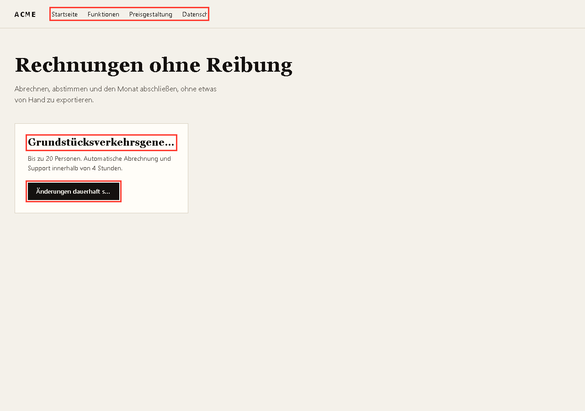
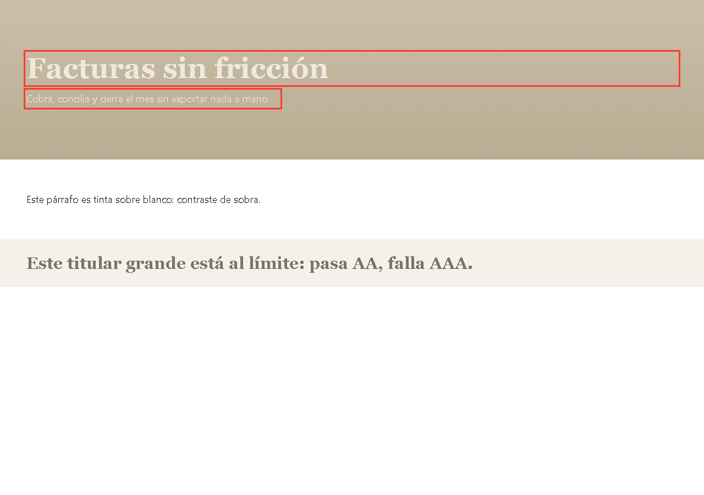

# agent-skills-qa

Cinco skills para agentes que auditan una web con evidencia. Sin claves de API, sin modelos, todo local.



## Las skills

| Skill | Qué demuestra | Estado |
|---|---|---|
| [`rompelayout`](skills/rompelayout) | dónde se rompe la web al cambiar de idioma | motor + tests |
| [`contraste-real`](skills/contraste-real) | si el texto se lee encima de una foto o un degradado | motor + tests |
| [`formulario-que-no-miente`](skills/formulario-que-no-miente) | si el formulario falla al enviar vacío, con doble clic o sin lector de pantalla | motor + tests |
| [`dice-vs-hace`](skills/dice-vs-hace) | si el agente dice la verdad al cerrar una tarea | procedimiento |
| [`declaracion-eaa`](skills/declaracion-eaa) | la declaración de accesibilidad y el expediente que pide la EAA | procedimiento |

## Por qué juntas

La EAA se aplica desde junio de 2025. Comercio y servicios cubiertos necesitan una declaración de accesibilidad **publicada** y un **expediente** que la respalde. La automatización detecta en torno al 57% de los problemas; el resto es manual y hay que documentarlo.

```
web-qa-visual ─┐
contraste-real ─┤
formulario ─────┼─→ evidencia fechada ─→ declaracion-eaa
rompelayout ────┤
dice-vs-hace ───┘   (nada se declara sin prueba)
```



## Instalar

Copia cada carpeta de `skills/` a `~/.config/opencode/skill/` o `~/.claude/skills/`.

Cada skill se activa por su descripción; no hay que invocarla a mano.

## Uso

```bash
node skills/rompelayout/rompelayout.mjs "https://tuweb.com/{locale}/" --locales es,en,de
node skills/contraste-real/contraste.mjs https://tuweb.com --level AA
```

Las dos salen con código 1, así que valen como gate de CI.

## Configuración

Cada skill con motor lee su `config.json`. Precedencia: **defaults → `config.json` → `--config otro.json` → flag**. Un flag desconocido falla en vez de ignorarse.

```json
{ "level": "AA", "target": null, "width": 1280, "maxItems": 30 }
```

## Tests

```bash
npm test              # contrato de las skills + rompelayout + contraste-real
npm run test:launch   # skill-launch (Python + Pillow)
```

Todo corre contra fixtures que rompen a propósito. Sin red, sin claves, sin modelos.

```
  rompelayout                 341 chars
  contraste-real              300 chars
  ...
ok: 5 skills cumplen el contrato
ok: 2 hard breaks + 2 ellipsis, clean locales pass, bad flags fail, config respected
ok: AA gradient, AAA borderline, target override, config respected, bad flags fail
ok: 7 checks catch the liar, 7 pass on the honest form, config respected
```

## Probado contra webs reales

`node bench/run.mjs` lanza los motores contra 11 URLs públicas. Resultados, falsos positivos encontrados y límites en [`BENCH.md`](BENCH.md).

- `rompelayout`: 0 roturas nuevas en 6 sitios multiidioma.
- `contraste-real`: 808 textos medidos en Wikipedia y 274 en Stripe, con los falsos positivos documentados y corregidos.
- `formulario-que-no-miente` no se prueba en sitios de terceros: no se envían datos a quien no te ha dado permiso.

## Fuentes

- [`SOURCES.md`](SOURCES.md): cada número que aparece aquí, con enlace.

## Extra

[`tools/skill-launch`](tools/skill-launch) genera la tarjeta social, el GIF, el README y los borradores de lanzamiento de cualquier skill.

## Licencia

MIT.
