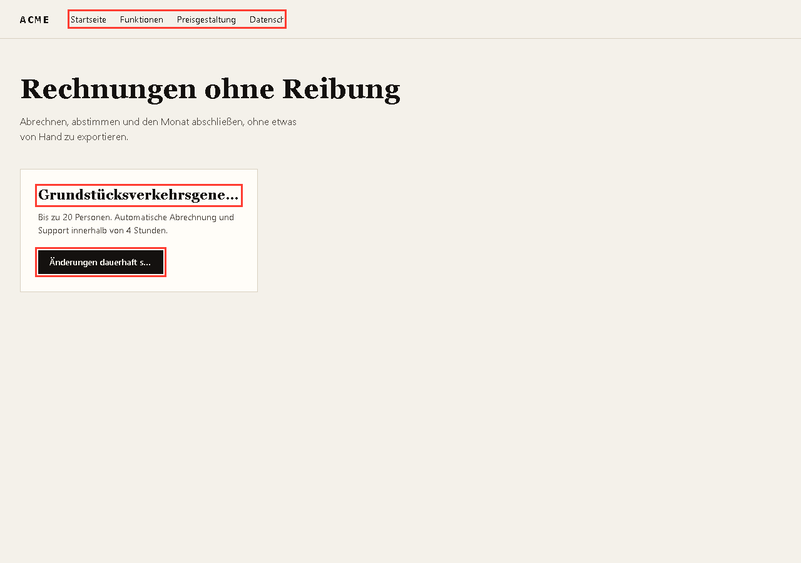

# rompelayout

Encuentra dónde se rompe tu interfaz cuando la traduces.



El alemán es más largo que el inglés, y el español también. Tu maquetación no lo sabe: el botón se corta, el `h2` se come la última palabra y el menú se sale. Esto lo detecta en un comando, con captura y selector.

## Uso

```bash
npm i -D playwright && npx playwright install chromium

node rompelayout.mjs "https://tuweb.com/{locale}/" --locales es,en,de
node rompelayout.mjs "./site/{locale}.html" --locales es,en,de --width 375
```

```
locale  problemas   notas
----------------------------------------------------------
es      0
en      0
de      3

de  → ./shots/de.png
  [child-out ] body > header.nav > nav.nav-links
               "Startseite Funktionen Preisgestaltung Datenschutzerklärung"
  [clipped-x ] body > main > div.card > h2
               "Grundstücksverkehrsgenehmigung"
```

Sale con código 1 si un idioma que no es el base rompe, así que vale como gate de CI.

## Qué comprueba

| Check | Qué es |
|---|---|
| `clipped-x` / `clipped-y` | texto cortado por `overflow: hidden/clip` o `text-overflow: ellipsis` |
| `child-out` | un hijo se sale de un contenedor que recorta |
| `viewport` | el elemento se sale del ancho de pantalla |
| scroll horizontal | la página entera gana scroll lateral en ese idioma |

## Qué no hace

- No traduce. Tú le das la URL de cada idioma ya traducida.
- No compara píxeles entre idiomas. Para regresión visual están Percy, Chromatic o Playwright con snapshots.
- No detecta solapamientos ni texto encima de una imagen.
- Solo ve el estado inicial de la página: no abre modales ni menús.
- La detección se apoya en `overflow` calculado. Un texto que se sale sin recorte no lo marca.

## Por qué existe

Las herramientas de i18n validan claves y plurales. Las de regresión visual comparan capturas entre versiones. Nadie te decía *qué elemento rompió por culpa del idioma*, y eso es lo que se arregla antes de publicar.

## Licencia

MIT.
